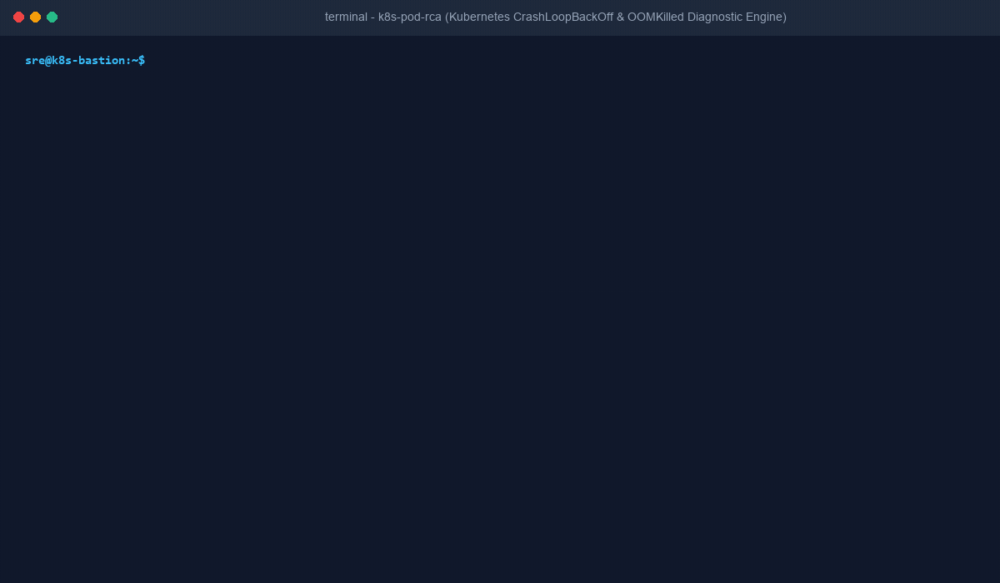

# Kubernetes CrashLoopBackOff & OOMKilled RCA (`k8s-pod-rca`)

[](https://kubernetes.io/)
[](LICENSE)
[-brightgreen.svg)]()
[]()
[]()
[]()

> Deterministic root-cause analysis engine and read-only diagnostic collector for Kubernetes pods failing with `CrashLoopBackOff`, `OOMKilled` (Exit Code 137), `ImagePullBackOff`, `CreateContainerConfigError`, `Init:CrashLoopBackOff`, or probe misconfigurations. Generates sanitized executive SRE RCA incident reports, declarative YAML manifest patches (`diff -u`), and verification runbooks without cluster mutation.

---



*Terminal demonstration: Ingesting raw Kubernetes pod JSON dumps and describe logs, scrubbing internal cluster telemetry client-side, isolating Exit 137 OOMKilled vs premature probe kills, and generating production-ready YAML manifest diffs.*

---

## Non-Technical Stakeholder Overview

### 1. The One-Sentence Pitch
`k8s-pod-rca` correlates scattered Kubernetes container statuses, `--previous` logs, namespace events, and cgroup resource limits to pinpoint why a workload is crashing and outputs an exact, declarative YAML patch without modifying live cluster resources.

### 2. The Real-World Problem
When containerized microservices crash in production Kubernetes clusters, platform and site reliability engineers face repetitive, high-stress investigation bottlenecks:
- **Misleading Current Logs:** Engineers often inspect current container logs instead of `--previous` termination logs, missing the actual crash stack trace.
- **The Exit Code 137 Ambiguity Trap:** Linux kernel cgroup OOM kills and liveness probe timeouts both terminate containers with signal 9 (`SIGKILL` = `128 + 9 = 137`). Engineers frequently raise memory limits unnecessarily when the true issue is a premature liveness probe timing out during cold startup.
- **Blind Resource Over-Provisioning:** Bumping pod memory limits without analyzing JVM heap percentages (`-XX:MaxRAMPercentage`) or Node.js garbage collection (`--max-old-space-size`) wastes cloud infrastructure spend or shifts the failure to node-level memory pressure.
- **Sensitive Data Leakage:** Manually copying raw `kubectl describe` outputs or container environment variables into tickets or external chat channels inadvertently exposes database passwords, internal IP addresses, service account tokens, and cluster topology.

### 3. The 3-Step Walkthrough
1. **Gather Telemetry via Read-Only Snapshot:** Run the zero-dependency collector (`scripts/collect-k8s-pod-triage.sh` or `scripts/collect-k8s-pod-triage.ps1`) to capture pod specs, container states, `--previous` logs, and namespace events without write permissions.
2. **Deterministic Correlation & Client-Side Sanitization:** The engine parses the data, sanitizes all internal IP addresses, service hostnames, and secrets, decodes exit codes (137, 143, 139, 126, 127), and measures container survival duration against probe intervals.
3. **Declarative Manifest Diff & Runbook Output:** The tool generates an executive RCA incident report alongside a unified YAML patch (`diff -u`) correcting memory limits, runtime heap flags, probe geometries, or missing secrets.

### 4. Why IT Leadership Approves
- **Strictly Read-Only (Zero Mutation Risk):** Neither the collector nor the diagnostic engine executes mutating commands (`apply`, `delete`, `patch`, `scale`, `exec`). Cluster state remains untouched.
- **Automated Client-Side Data Sanitization:** Scrubs RFC 1918 private IPs, container registry domains, namespace identifiers, and base64/environment secrets before telemetry leaves the local machine.
- **Zero Third-Party Dependencies:** Implemented strictly with the Python standard library (Python 3.9+) and native shell/PowerShell. Requires no package installations, no external network access, and no daemon processes.
- **Infrastructure Cost Optimization:** Differentiates genuine memory leaks from startup probe delays, preventing needless resource request inflation and wasteful cloud cluster over-provisioning.

---

## Hands-On Testing Walkthrough

You can test this tool directly on your local workstation using the included synthetic mock fixtures. No live Kubernetes cluster, cloud credentials, or administrative privileges are required.

### 1. Diagnose a Cgroup OOMKilled Container (Exit Code 137)
Analyze a high-throughput Node.js microservice crashing due to memory exhaustion beyond its 512Mi cgroup limit:

```bash
python scripts/k8s_pod_rca.py -i tests/fixtures/fixture-oomkilled-cgroup-limit.json --sanitize
```

**Expected Results:**
- Classification: `Cgroup Memory Limit Exceeded (OOMKilled)`
- Exit Code: `137` (`SIGKILL` via kernel OOM killer)
- Declarative YAML Diff: Adjusts memory limit to `1024Mi`, sets request to `512Mi`, and injects `--max-old-space-size=768`

### 2. Disambiguate a Premature Liveness Probe Kill
Diagnose a Java Spring Boot service terminating with Exit 137 where memory was sufficient, but a 1-second probe timeout killed the service during startup:

```bash
python scripts/k8s_pod_rca.py -i tests/fixtures/fixture-liveness-probe-timeout.txt --sanitize
```

**Expected Results:**
- Classification: `Premature Liveness Probe Termination`
- Disambiguation: Identifies `Unhealthy` probe event rather than `reason: OOMKilled`
- Declarative YAML Diff: Introduces dedicated `startupProbe` (`failureThreshold: 30`, `periodSeconds: 5`), increases probe `timeoutSeconds` to `5`, and adjusts `livenessProbe.initialDelaySeconds`

### 3. Diagnose Missing ConfigMap / Secret (`CreateContainerConfigError`)
Analyze a pod failing prior to container initialization due to a missing Secret key reference:

```bash
python scripts/k8s_pod_rca.py -i tests/fixtures/fixture-configmap-missing-secret.json --sanitize
```

**Expected Results:**
- Classification: `Configuration or Secret Missing (CreateContainerConfigError)`
- Specific Missing Resource: `secret "db-credentials" not found`
- Remediating Action: Step-by-step secret creation and pod recovery procedure

### 4. Diagnose Non-Root Permission Denied (Exit Code 126)
Analyze a hardened non-root container failing to execute an entrypoint script:

```bash
python scripts/k8s_pod_rca.py -i tests/fixtures/fixture-entrypoint-permission-denied.txt --sanitize
```

**Expected Results:**
- Classification: `Container Entrypoint Execution Failure (Permission Denied)`
- Technical Context: Identifies missing execute permissions (`chmod +x`) or read-only filesystem restriction
- Declarative YAML Diff: Adds `emptyDir` mount for `/tmp` and adjusts `securityContext`

### 5. Multi-Format Export Options
Generate machine-readable JSON for automated incident routing (Slack, PagerDuty, ServiceNow) or static HTML:

```bash
# Export structured incident JSON
python scripts/k8s_pod_rca.py -i tests/fixtures/fixture-oomkilled-cgroup-limit.json --output-format json --output report.json

# Export formatted HTML incident summary
python scripts/k8s_pod_rca.py -i tests/fixtures/fixture-oomkilled-cgroup-limit.json --output-format html --output report.html

# Generate sanitized SRE portfolio proof-of-work case study
python scripts/k8s_pod_rca.py -i tests/fixtures/fixture-oomkilled-cgroup-limit.json --generate-proof-of-work
```

---

## Live Cluster Telemetry Acquisition

When diagnosing live production incidents, use the provided read-only snapshot scripts to capture all necessary diagnostic telemetry with a single command.

### Linux / macOS (Bash)
```bash
# Grant execution permissions
chmod +x scripts/collect-k8s-pod-triage.sh

# Capture sanitized triage snapshot
./scripts/collect-k8s-pod-triage.sh \
  --namespace production \
  --pod payment-processor-7d9c8b6f4-x9k2m \
  --sanitize \
  --output triage-snapshot.json
```

### Windows (PowerShell)
```powershell
.\scripts\collect-k8s-pod-triage.ps1 `
  -Namespace "production" `
  -PodName "payment-processor-7d9c8b6f4-x9k2m" `
  -Sanitize `
  -OutputFile "triage-snapshot.json"
```

### Security Verification of Collector Operations
The collector executes exclusively read-only commands:
- `kubectl get pod <pod> -n <ns> -o json`
- `kubectl describe pod <pod> -n <ns>`
- `kubectl logs <pod> -n <ns> --all-containers --previous --tail=250`
- `kubectl get events -n <ns> --field-selector involvedObject.name=<pod>`
- `kubectl top pod <pod> -n <ns>` (if metrics-server is available)

The script never invokes `kubectl delete`, `kubectl patch`, `kubectl apply`, or `kubectl exec`.

---

## Technical Architecture & Signal Mathematics

### Linux Termination Signal Matrix (`128 + N`)

| Exit Code | Signal / Name | Trigger Mechanism | Kubernetes Troubleshooting Distinction |
| :--- | :--- | :--- | :--- |
| **`137`** | `SIGKILL` (Signal 9) | Cgroup Memory Exhaustion (`reason: OOMKilled`) | Linux kernel killed process immediately. Heap limit exceeded container limit. |
| **`137`** | `SIGKILL` (Signal 9) | Liveness Probe Expiration (`reason: Error`) | Probe failed. Process ignored `SIGTERM` past `terminationGracePeriodSeconds`. |
| **`143`** | `SIGTERM` (Signal 15) | Graceful Termination Request | Node drain, pod eviction, or orderly liveness probe failure response. |
| **`139`** | `SIGSEGV` (Signal 11) | Segmentation Fault | Unhandled memory violation in native C/C++ libraries, Rust bindings, or JVM. |
| **`126`** | Permission Denied | Entrypoint binary cannot execute | Missing executable flag (`+x`) or running non-root on restricted filesystem. |
| **`127`** | File Not Found | Command not in `$PATH` | Bad entrypoint path, missing interpreter, or architecture mismatch (`exec format error`). |
| **`1` / `2`** | General Error | Application-level exception | Uncaught exception, syntax error, failed DB migration, missing required env var. |

### Container Survival Duration Calculation
The diagnostic engine compares container lifecycle timestamps:
$$\Delta T = T_{\text{finished}} - T_{\text{started}}$$

- **$\Delta T < 2$ seconds:** Instant boot failure (Exit 126, 127, syntax error, missing config file).
- **$\Delta T \approx T_{\text{initialDelay}} + (T_{\text{period}} \times N_{\text{threshold}}):$** Definitive mathematical footprint of a **Premature Liveness Probe Kill**.
- **$\Delta T \gg 60$ seconds with memory growth:** Progressive memory leak ending in Cgroup OOM.

---

## Automated Test Harness

The skill includes an automated test harness covering standard validation, stress testing, extreme payloads, and advanced runtime edge cases.

```bash
# 1. Standard Enterprise Skill Validation (20 tests)
python tests/validate-skill.py

# 2. High-Throughput Stress Testing (12 tests)
python tests/stress_test_k8s_pod_rca.py

# 3. Security, ReDoS, and Edge Payload Testing (20 tests)
python tests/extreme_test_k8s_pod_rca.py

# 4. Advanced Runtime & Architecture Edge Cases (20 tests)
python tests/advanced_edge_cases_test.py
```

### Test Coverage Highlights
- **72 total automated tests** returning exit code 0 across all test suites.
- **High-throughput processing:** Ingests 50,000 log lines in ~0.06 seconds (>800,000 lines/second).
- **ReDoS resilience:** Bounded RFC regex engines prevent polynomial backtracking on adversarial input strings.
- **100% Synthetic Identifiers:** All fixtures utilize obvious mock identifiers (`mock-pod-01`, `synthetic-test.local`, `192.0.2.1`).

---

## Installation & Setup Guide

### 1. AI Agent Environments

#### `agentskills.io` / Antigravity
Clone or link the skill directory into your active agent workspace:
```bash
git clone https://github.com/ToritsejuBoyo/k8s-pod-rca.git skills/k8s-pod-rca
```

#### Claude Code
Add to your Claude Code configuration or reference `SKILL.md` directly:
```bash
claude config add-skill ./skills/k8s-pod-rca/SKILL.md
```

#### Cursor
Reference the rules and skills directory in your project's `.cursorrules` or prompt context:
```markdown
Follow the Kubernetes RCA workflow defined in skills/k8s-pod-rca/SKILL.md.
```

### 2. Standalone CLI Usage (Without AI Agent)
The diagnostic engine operates independently as a standard CLI utility:

```bash
# Clone repository
git clone https://github.com/ToritsejuBoyo/k8s-pod-rca.git
cd k8s-pod-rca

# Run directly using Python standard library
python scripts/k8s_pod_rca.py --help
```

---

## Enterprise Compliance & Data Privacy

- **Read-Only Telemetry:** The collector utilizes only read-only audit permissions. Standard `view` or `read-only` RBAC roles are sufficient. Global Admin / Cluster Admin elevation is never required.
- **Automated PII & Secret Scrubbing:** The `--sanitize` flag ensures SHA-256 masking of user identifiers, zeros out internal IP addresses (RFC 1918), replaces secrets with `[REDACTED_SECRET]`, and obfuscates internal hostnames (`cluster.local`).
- **Zero Third-Party Code:** No untrusted packages from PyPI or external registries. Safe for execution in air-gapped, defense, healthcare, and financial environments.

---

## Repository Metadata

- **GitHub Topics:** `kubernetes`, `crashloopbackoff`, `oomkilled`, `sre`, `devops`, `incident-response`, `agent-skills`, `troubleshooting`
- **Primary Technical Reference:** [`references/k8s-exit-codes-and-probes.md`](references/k8s-exit-codes-and-probes.md)
- **Standard RCA Report Template:** [`assets/k8s-pod-rca-template.md`](assets/k8s-pod-rca-template.md)

---

## License

This project is licensed under the MIT License - see the [LICENSE](LICENSE) file for details.
Copyright (c) 2026 Toritseju Boyo.
